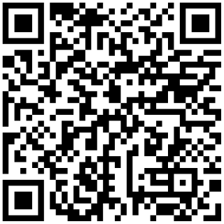

# Bulk dynamic QR codes from a CSV (Go)

Turn a CSV of names and URLs into dynamic QR codes and short links in one API call, with the official [Linkbreakers](https://linkbreakers.com/developers?utm_source=github&utm_content=bulk-dynamic-qr-codes-from-csv-go) Go SDK, then pull each code's scan count back into a CSV. The same example in [Python](../bulk-dynamic-qr-codes-from-csv-python) and [TypeScript](../bulk-dynamic-qr-codes-from-csv-typescript).

- **In:** `links.csv` with `name,destination`
- **Out:** `links_out.csv` (short link and id per row) and one SVG QR code per row in `qr/`
- **Report:** `scan_report.csv` with the scan count of every link

The codes are dynamic: each one points at a short link, so you can change where it goes later without reprinting it.



*Created by the run below: it opens `https://linkbreak.ing/m6_49QynM`, which redirects to a restaurant's dinner menu.*

## Quickstart

You need Go 1.23+ and a Linkbreakers workspace API token with the `links:read` and `links:write` scopes ([create one here](https://app.linkbreakers.com/workspace/dashboard/api-tokens); [what tokens and scopes are](https://linkbreakers.com/help/article/what-are-api-tokens?utm_source=github&utm_content=bulk-dynamic-qr-codes-from-csv-go)).

```bash
git clone https://github.com/linkbreakers-com/examples.git
cd examples/bulk-dynamic-qr-codes-from-csv-go

cp .env.example .env          # then paste your token after LINKBREAKERS_TOKEN=
go run . create links.csv
go run . report
```

Replace `links.csv` with your own file. The only columns read are `name` and `destination`. `go test ./...` runs the code against a mocked API, with no token and no credits.

## Sample output

A real run against the Linkbreakers API on 2026-11-06, with the `links.csv` in this directory:

```text
$ go run . create links.csv
https://linkbreak.ing/m6_49QynM  Dinner menu
https://linkbreak.ing/uy_491mnp  Store locator
https://linkbreak.ing/DowfrQmcM  Cookie recipe

3 dynamic QR codes created. Links: links_out.csv  Images: qr/
```

`links_out.csv`:

```csv
name,destination,short_link,link_id,qr_code_file
Dinner menu,https://peterluger.com/pages/menus,https://linkbreak.ing/m6_49QynM,74abb8d4-b6bb-46b8-92b6-b7b83e7b09b6,qr/m6_49QynM.svg
Store locator,https://www.ikea.com/us/en/stores/,https://linkbreak.ing/uy_491mnp,423c2f01-fed1-4e6b-9149-bea8fa77bc72,qr/uy_491mnp.svg
Cookie recipe,https://www.kingarthurbaking.com/recipes/chocolate-chip-cookies-recipe,https://linkbreak.ing/DowfrQmcM,4499fe6a-f211-4d6c-b9dd-8cedd9781239,qr/DowfrQmcM.svg
```

After a few test scans (requests to each code's scan URL):

```text
$ go run . report
     2  https://linkbreak.ing/m6_49QynM  Dinner menu
     1  https://linkbreak.ing/uy_491mnp  Store locator
     1  https://linkbreak.ing/DowfrQmcM  Cookie recipe

Scan report: scan_report.csv
```

## How it works

`main.go` uses only the standard library, the SDK and `godotenv`, and makes three SDK calls, all on `client.LinksAPI`:

1. **`LinksServiceCreateBulk`** creates up to 250 links per request (the API's limit; larger files are sent in batches of 250 with `slices.Chunk`). A batch is transactional: if one row is invalid, none of that batch is created. Each link gets the tag `csv-import`.

   ```go
   res, _, err := c.links.LinksServiceCreateBulk(ctx).
   	CreateBulkLinksRequest(*linkbreakers.NewCreateBulkLinksRequest(requests)).
   	IdempotencyKey(key).
   	Execute()
   ```

2. **`LinksServiceResolveQrcodeImages`** returns a signed URL for each link's QR code. The codes are drawn in the background right after the call, so the program asks every 2 seconds (for up to 30 seconds) until every link has one. The URLs expire, so it downloads the SVGs right away into `qr/<shortlink>.svg`.
3. **`LinksServiceGet`** (in `report`) reads each link's `EventCount`, the number of scans and clicks. It is not instant: in the run above, the counts had caught up within about two minutes of the scans.

The token travels in the context, as every SDK call expects: `context.WithValue(ctx, linkbreakers.ContextAccessToken, token)`. When a call fails, the API's explanation is in the `*linkbreakers.GenericOpenAPIError` the SDK returns; `main` prints its `Body()`.

Each batch is sent with an `Idempotency-Key` derived from its contents. If a run fails after a batch was answered (a failed download, a crash), running it again with the same CSV within 24 hours gets the first response back instead of creating the links twice.

Scanning a code opens `https://linkbreak.ing/<shortlink>?lbsrc=qrcode`, which redirects to the destination; the `lbsrc` parameter is how Linkbreakers tells a scan from a click on the short link.

## Good to know

- Every created link uses your plan's platform credits. When a batch needs more than you have left, the API answers `INSUFFICIENT_PLATFORM_CREDITS` and creates nothing.
- The SVGs have a transparent background. Put them on a light background when you print them.
- To send a code somewhere else later, change the link's destination in the dashboard or with `LinksServiceUpdate`; the printed code stays the same.
- The SDK is the [`linkbreakers-go`](https://pkg.go.dev/github.com/linkbreakers-com/linkbreakers-go) module, generated from the API's OpenAPI document, so every endpoint has a typed method.
- Going further: [Go SDK quickstart](https://linkbreakers.com/help/article/golang-sdk-quickstart?utm_source=github&utm_content=bulk-dynamic-qr-codes-from-csv-go), [bulk QR codes without code](https://linkbreakers.com/help/article/how-to-bulk-create-qr-codes-in-linkbreakers?utm_source=github&utm_content=bulk-dynamic-qr-codes-from-csv-go), [all developer docs](https://linkbreakers.com/developers?utm_source=github&utm_content=bulk-dynamic-qr-codes-from-csv-go).

## License

MIT, see [LICENSE](../LICENSE).
