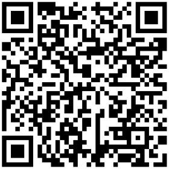

# Bulk dynamic QR codes from a CSV (Python)

Turn a CSV of names and URLs into dynamic QR codes and short links in one API call, with the official [Linkbreakers](https://linkbreakers.com/developers?utm_source=github&utm_content=bulk-dynamic-qr-codes-from-csv-python) Python SDK, then pull each code's scan count back into a CSV.

- **In:** `links.csv` with `name,destination`
- **Out:** `links_out.csv` (short link and id per row) and one SVG QR code per row in `qr/`
- **Report:** `scan_report.csv` with the scan count of every link

The codes are dynamic: each one points at a short link, so you can change where it goes later without reprinting it.



*Created by the run below: it opens `https://linkbreak.ing/PMVw9HynM`, which redirects to the Wikipedia article on QR codes.*

## Quickstart

You need Python 3.9+ and a Linkbreakers workspace API token with the `links:read` and `links:write` scopes ([create one here](https://app.linkbreakers.com/workspace/dashboard/api-tokens); [what tokens and scopes are](https://linkbreakers.com/help/article/what-are-api-tokens?utm_source=github&utm_content=bulk-dynamic-qr-codes-from-csv-python)).

```bash
git clone https://github.com/linkbreakers-com/examples.git
cd examples/bulk-dynamic-qr-codes-from-csv-python

python -m venv .venv && . .venv/bin/activate
pip install -r requirements.txt

cp .env.example .env          # then paste your token after LINKBREAKERS_TOKEN=
python bulk_qr.py create links.csv
python bulk_qr.py report
```

Replace `links.csv` with your own file. The only columns read are `name` and `destination`.

## Sample output

A real run against the Linkbreakers API on 2026-10-27, with the `links.csv` in this directory:

```text
$ python bulk_qr.py create links.csv
https://linkbreak.ing/PMVw9HynM  QR code on Wikipedia
https://linkbreak.ing/QpVwrTmnM  Python home page
https://linkbreak.ing/xHV6rHynM  OpenStreetMap

3 dynamic QR codes created. Links: links_out.csv  Images: qr/
```

`links_out.csv`:

```csv
name,destination,short_link,link_id,qr_code_file
QR code on Wikipedia,https://en.wikipedia.org/wiki/QR_code,https://linkbreak.ing/PMVw9HynM,e923a056-c82c-47bb-888b-76a9464c1948,qr/PMVw9HynM.svg
Python home page,https://www.python.org/,https://linkbreak.ing/QpVwrTmnM,0e5b6e82-a7d3-4e58-8740-cd231553a6a3,qr/QpVwrTmnM.svg
OpenStreetMap,https://www.openstreetmap.org/,https://linkbreak.ing/xHV6rHynM,383cc4f2-75cb-42d6-90fd-40e8c32a4012,qr/xHV6rHynM.svg
```

After a few test visits:

```text
$ python bulk_qr.py report
     2  https://linkbreak.ing/PMVw9HynM  QR code on Wikipedia
     1  https://linkbreak.ing/QpVwrTmnM  Python home page
     1  https://linkbreak.ing/xHV6rHynM  OpenStreetMap

Scan report: scan_report.csv
```

## How it works

`bulk_qr.py` is about 150 lines and makes three SDK calls:

1. **`LinksApi.links_service_create_bulk`** creates up to 250 links per request (the API's limit; larger files are sent in batches of 250). A batch is transactional: if one row is invalid, none of that batch is created. Each link gets the tag `csv-import` and `wait_for_qrcode=True`, so its QR code exists when the call returns.
2. **`LinksApi.links_service_resolve_qrcode_images`** returns a signed URL for each link's QR code. The URLs expire, so the script downloads the SVGs right away into `qr/<shortlink>.svg`.
3. **`LinksApi.links_service_get`** (in `report`) reads each link's `event_count`, the number of scans and clicks. It updates within a few seconds of a scan.

Each batch is sent with an `Idempotency-Key` derived from its contents. If a run fails halfway (a timeout, a failed download), running it again with the same CSV within 24 hours gets the first response back instead of creating the links twice.

Scanning a code opens `https://linkbreak.ing/<shortlink>?lbsrc=qrcode`, which redirects to the destination; the `lbsrc` parameter is how Linkbreakers tells a scan from a click on the short link.

## Good to know

- Every created link uses your plan's platform credits. When a batch needs more than you have left, the API answers `INSUFFICIENT_PLATFORM_CREDITS` and creates nothing.
- The SVGs have a transparent background. Put them on a light background when you print them.
- To send a code somewhere else later, change the link's destination in the dashboard or with `LinksApi.links_service_update`; the printed code stays the same.
- Going further: [Python SDK quickstart](https://linkbreakers.com/help/article/python-sdk-quickstart?utm_source=github&utm_content=bulk-dynamic-qr-codes-from-csv-python), [bulk QR codes without code](https://linkbreakers.com/help/article/how-to-bulk-create-qr-codes-in-linkbreakers?utm_source=github&utm_content=bulk-dynamic-qr-codes-from-csv-python), [all developer docs](https://linkbreakers.com/developers?utm_source=github&utm_content=bulk-dynamic-qr-codes-from-csv-python).

## License

MIT, see [LICENSE](../LICENSE).
