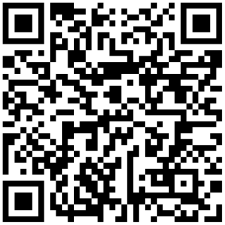

# Bulk dynamic QR codes from a CSV (Python)

Turn a CSV of names and URLs into dynamic QR codes and short links in one API call, with the official [Linkbreakers](https://linkbreakers.com/developers?utm_source=github&utm_content=bulk-dynamic-qr-codes-from-csv-python) Python SDK, then pull each code's scan count back into a CSV. The same example in TypeScript: [`bulk-dynamic-qr-codes-from-csv-typescript`](../bulk-dynamic-qr-codes-from-csv-typescript).

- **In:** `links.csv` with `name,destination`
- **Out:** `links_out.csv` (short link and id per row) and one SVG QR code per row in `qr/`
- **Report:** `scan_report.csv` with the scan count of every link

The codes are dynamic: each one points at a short link, so you can change where it goes later without reprinting it.



*Created by the run below: it opens `https://linkbreak.ing/Un94UKynM`, which redirects to a steakhouse's dinner menu.*

## Quickstart

You need Python 3.9+ and a Linkbreakers workspace API token with the `links:read` and `links:write` scopes ([create one here](https://app.linkbreakers.com/workspace/dashboard/api-tokens); [what tokens and scopes are](https://linkbreakers.com/help/article/what-are-api-tokens?utm_source=github&utm_content=bulk-dynamic-qr-codes-from-csv-python)).

```bash
git clone https://github.com/linkbreakers-com/examples.git
cd examples/bulk-dynamic-qr-codes-from-csv-python

python -m venv .venv && . .venv/bin/activate
pip install -r requirements.txt

cp .env.example .env          # then paste your token after LINKBREAKERS_TOKEN=
python bulk_qr.py create links.csv
python bulk_qr.py report
```

Replace `links.csv` with your own file. The only columns read are `name` and `destination`.

## Sample output

A real run against the Linkbreakers API on 2026-11-04, with the `links.csv` in this directory:

```text
$ python bulk_qr.py create links.csv
https://linkbreak.ing/Un94UKynM  Dinner menu
https://linkbreak.ing/fx94Idycp  Store locator
https://linkbreak.ing/sirfUKmnM  Museum visit

3 dynamic QR codes created. Links: links_out.csv  Images: qr/
```

`links_out.csv`:

```csv
name,destination,short_link,link_id,qr_code_file
Dinner menu,https://peterluger.com/pages/menus,https://linkbreak.ing/Un94UKynM,845a279e-f62c-4686-914b-f315e03dcb38,qr/Un94UKynM.svg
Store locator,https://www.target.com/store-locator/find-stores,https://linkbreak.ing/fx94Idycp,c9263bb0-fe5d-4597-9a91-07b2a9ee2ee1,qr/fx94Idycp.svg
Museum visit,https://www.louvre.fr/en/visit,https://linkbreak.ing/sirfUKmnM,659b556a-d994-4fe8-b19a-2ac28c8cc639,qr/sirfUKmnM.svg
```

After a few test scans:

```text
$ python bulk_qr.py report
     2  https://linkbreak.ing/Un94UKynM  Dinner menu
     1  https://linkbreak.ing/fx94Idycp  Store locator
     3  https://linkbreak.ing/sirfUKmnM  Museum visit

Scan report: scan_report.csv
```

## How it works

`bulk_qr.py` is about 170 lines and makes three SDK calls:

1. **`LinksApi.links_service_create_bulk`** creates up to 250 links per request (the API's limit; larger files are sent in batches of 250). A batch is transactional: if one row is invalid, none of that batch is created. Each link gets the tag `csv-import`.
2. **`LinksApi.links_service_resolve_qrcode_images`** returns a signed URL for each link's QR code. The codes are drawn in the background right after the call, so the script asks every 2 seconds (for up to 30 seconds) until every link has one. The URLs expire, so it downloads the SVGs right away into `qr/<shortlink>.svg`.
3. **`LinksApi.links_service_get`** (in `report`) reads each link's `event_count`, the number of scans and clicks. It is not instant: in the run above, the counts caught up within a minute of the scans.

Each batch is sent with an `Idempotency-Key` derived from its contents. If a run fails after a batch was answered (a failed download, a crash), running it again with the same CSV within 24 hours gets the first response back instead of creating the links twice.

Scanning a code opens `https://linkbreak.ing/<shortlink>?lbsrc=qrcode`, which redirects to the destination; the `lbsrc` parameter is how Linkbreakers tells a scan from a click on the short link.

## Good to know

- Every created link uses your plan's platform credits. When a batch needs more than you have left, the API answers `INSUFFICIENT_PLATFORM_CREDITS` and creates nothing.
- The SVGs have a transparent background. Put them on a light background when you print them.
- To send a code somewhere else later, change the link's destination in the dashboard or with `LinksApi.links_service_update`; the printed code stays the same.
- Going further: [Python SDK quickstart](https://linkbreakers.com/help/article/python-sdk-quickstart?utm_source=github&utm_content=bulk-dynamic-qr-codes-from-csv-python), [bulk QR codes without code](https://linkbreakers.com/help/article/how-to-bulk-create-qr-codes-in-linkbreakers?utm_source=github&utm_content=bulk-dynamic-qr-codes-from-csv-python), [all developer docs](https://linkbreakers.com/developers?utm_source=github&utm_content=bulk-dynamic-qr-codes-from-csv-python).

## License

MIT, see [LICENSE](../LICENSE).
