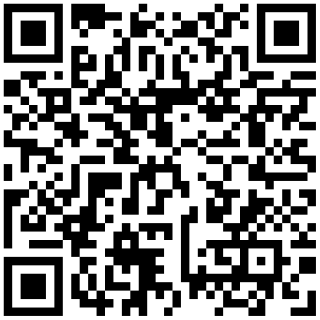

# QR code scans by product line and by country (Python)

Tag each packaging QR code with its product line, then read scans per product line and per country from the Linkbreakers analytics API, filtered by tag and by country, with the official [Linkbreakers](https://linkbreakers.com/developers?utm_source=github&utm_content=qr-code-scans-by-product-and-country-python) Python SDK. One script, about 150 lines.

- **In:** `codes.csv` with `product_line,name,destination`, one row per QR code (granola box, granola bar wrapper, cold brew can, cold brew bottle)
- **Out:** one dynamic QR code per row, tagged with its product line, saved as `qr/<shortlink>.svg`
- **Report:** a table of scans, product line by country, for the last `--days` days and the countries in `--countries`

```text
product line     NL     FR     DE   total
granola           5      0      0       5
cold-brew         3      0      0       3
```



*The Granola box code from the run below: it opens `https://linkbreak.ing/d0Pqd2mcM`, which redirects to a granola recipe.*

Video: [How to track QR code scans by product and country](https://www.youtube.com/watch?v=2g_J4D49BBc) (the same view in the dashboard). Written guide: [how to track QR code scans by product and country](https://linkbreakers.com/help/article/how-to-track-qr-code-scans-by-product-and-country?utm_source=github&utm_content=qr-code-scans-by-product-and-country-python).

## Quickstart

You need Python 3.9+ and a Linkbreakers workspace API token with the `links:read`, `links:write` and `analytics:read` scopes ([create one here](https://app.linkbreakers.com/workspace/dashboard/api-tokens); [what tokens and scopes are](https://linkbreakers.com/help/article/what-are-api-tokens?utm_source=github&utm_content=qr-code-scans-by-product-and-country-python)).

```bash
git clone https://github.com/linkbreakers-com/examples.git
cd examples/qr-code-scans-by-product-and-country-python

python -m venv .venv && . .venv/bin/activate
pip install -r requirements.txt

cp .env.example .env          # then paste your token after LINKBREAKERS_TOKEN=
python scans_by_product.py --countries FR,DE --days 30
```

The first run creates the codes and prints a table of zeros. Scan a code from `qr/` with your phone and run it again. Later runs reuse the codes (same name, same tag) instead of creating new ones.

Put your own product lines and pages in `codes.csv`. Options:

- `--countries FR,DE`: ISO 3166-1 alpha-2 codes. Without it, the columns are every country that scanned, most scans first.
- `--days 30`: how far back to count (default 30).
- `--codes codes.csv`, `--qr-dir qr`: input file and image folder.

## Sample output

A real run against the Linkbreakers API on 2026-11-02, with the `codes.csv` in this directory. The first run created the four codes:

```text
$ python scans_by_product.py --countries NL,FR,DE
created  granola      https://linkbreak.ing/d0Pqd2mcM  Granola box
created  granola      https://linkbreak.ing/e2xuKlycp  Granola bar wrapper
created  cold-brew    https://linkbreak.ing/ymWuK2mcM  Cold brew can
created  cold-brew    https://linkbreak.ing/3aOqKlmnp  Cold brew bottle
QR codes: qr/

Scans by product line and country, 2026-10-03 to 2026-11-02 (30 days)

product line     NL     FR     DE   total
granola           0      0      0       0
cold-brew         0      0      0       0
```

**Where the scans below came from:** eight test visits made right after, from one computer in Amsterdam, the Netherlands (its IP address geolocates to NL). Each one requested the URL the QR code encodes (`https://linkbreak.ing/<shortlink>?lbsrc=qrcode`) with an iPhone or Android browser user agent and no cookies, the way a phone opens a scanned code: 3 on the Granola box, 2 on the Granola bar wrapper, 2 on the Cold brew can, 1 on the Cold brew bottle. Linkbreakers recorded all eight as QR code scans from mobile devices in the Netherlands, and they count in analytics like any scan. No visits came from France or Germany, so those columns stay at 0.

```text
$ python scans_by_product.py --countries NL,FR,DE
reused   granola      https://linkbreak.ing/d0Pqd2mcM  Granola box
reused   granola      https://linkbreak.ing/e2xuKlycp  Granola bar wrapper
reused   cold-brew    https://linkbreak.ing/ymWuK2mcM  Cold brew can
reused   cold-brew    https://linkbreak.ing/3aOqKlmnp  Cold brew bottle
QR codes: qr/

Scans by product line and country, 2026-10-03 to 2026-11-02 (30 days)

product line     NL     FR     DE   total
granola           5      0      0       5
cold-brew         3      0      0       3
```

Without `--countries`, the columns are the countries that scanned:

```text
$ python scans_by_product.py
...
product line     NL   total
granola           5       5
cold-brew         3       3
```

## How it works

`scans_by_product.py` makes five SDK calls:

1. **`LinksApi.links_service_list(tags=[product_line])`** finds the codes already carrying the tag (this filter takes tag names). **`links_service_create`** creates the missing ones with `CreateLinkRequest(name=..., destination=..., tags=[product_line], wait_for_qrcode=True)`. A tag that does not exist yet is created with the link.
2. **`LinksApi.links_service_resolve_qrcode_images`** returns a signed URL for each QR code. The URLs expire, so the script downloads the SVGs right away.
3. **`TagsApi.tags_service_list(search=product_line)`** turns each tag name into its ID. The analytics filter takes the tag ID, and `search` matches partial names, so the script keeps the exact match.
4. **`AnalyticsDataApi.analytics_data_service_get_breakdown`**, once per product line, with:

   ```python
   GetBreakdownRequest(
       dimension="country",
       tag_id=granola_tag_id,      # every link carrying the tag
       countries=["FR", "DE"],     # visits from any of these countries
       start_date=start,
       end_date=end,
   )
   ```

   It answers one row per country, with the ISO code in `code` and the country name in `label`. A country with no scans has no row; the script prints 0.

The same call in REST:

```bash
curl -s https://api.linkbreakers.com/v1/analytics/breakdown \
  -H "Authorization: Bearer $LINKBREAKERS_TOKEN" \
  -H "Content-Type: application/json" \
  -d '{"dimension": "country", "tagId": "<granola tag id>", "countries": ["NL", "FR", "DE"],
       "startDate": "2026-10-03T00:00:00Z", "endDate": "2026-11-03T00:00:00Z"}'
```

What it answered for the `granola` tag in this run:

```json
{"data": [{"label": "Netherlands", "eventCount": 5, "percentage": 100, "code": "NL"}], "total": 5}
```

`tag_id` and `countries` work on the other analytics reads too: geo, devices, visitor trends, time series, top links, funnels, attributes ([the full list](https://linkbreakers.com/help/article/one-filter-bar-with-tag-and-country-filters?utm_source=github&utm_content=qr-code-scans-by-product-and-country-python)).

## Limits

- **Country only.** The country is the one of the scanning device's IP address at the moment of the scan: a shopper scanning abroad counts toward the country they are in, a VPN scan toward the VPN's country. There is no region, state or city filter (the `city` dimension breaks scans down by city, but you cannot filter on one). More in [does a QR code show location?](https://linkbreakers.com/help/article/does-a-qr-code-show-location-accuracy-limits-and-examples?utm_source=github&utm_content=qr-code-scans-by-product-and-country-python)
- **One of `link_id`, `directory_id` and `tag_id` per query.** Sending two answers `400`:

  ```text
  {"code":3,"codeType":"LINK_FILTER_LINK_AND_DIRECTORY","message":"send at most one of link_id, directory_id and tag_id: they each choose which links count","details":[]}
  ```

  To read two product lines together, give their codes a shared tag as well (`beverages` on the cold brew and sparkling water codes). A link can carry several tags and counts under each.
- **Country codes are not validated by the API.** `countries=["France"]` answers an empty list, not an error, so the script checks for two letters before calling.
- **Scans and clicks.** The counts are QR code scans plus opens of the short link itself, the same numbers as the dashboard. A scan opens `...?lbsrc=qrcode`, which is how Linkbreakers tells the two apart.
- Every created link uses your plan's platform credits. Tags and the country filter are on every plan; [directories](https://linkbreakers.com/help/article/what-is-a-directory-in-linkbreakers?utm_source=github&utm_content=qr-code-scans-by-product-and-country-python) need Pro or Enterprise.

## Good to know

- **Codes you already printed:** add the tag with `LinksApi.links_service_update(link_id, LinksServiceUpdateBody(tags=["granola"]))`. It sets the whole list, so include the tags the link already has. Scans recorded before the tag was added count too: the filter selects links, not visits.
- **Change where a code goes** in the dashboard or with `links_service_update`; the printed code stays the same.
- The SVGs have a transparent background. Put them on a light background when you print them.
- Going further: [how to use QR codes on product packaging](https://linkbreakers.com/help/article/how-to-use-qr-codes-on-product-packaging?utm_source=github&utm_content=qr-code-scans-by-product-and-country-python), [how to use tags to segment QR campaigns](https://linkbreakers.com/help/article/how-to-use-tags-to-segment-and-analyze-qr-campaigns?utm_source=github&utm_content=qr-code-scans-by-product-and-country-python), [Python SDK quickstart](https://linkbreakers.com/help/article/python-sdk-quickstart?utm_source=github&utm_content=qr-code-scans-by-product-and-country-python), [all developer docs](https://linkbreakers.com/developers?utm_source=github&utm_content=qr-code-scans-by-product-and-country-python).

## License

MIT, see [LICENSE](../LICENSE).
